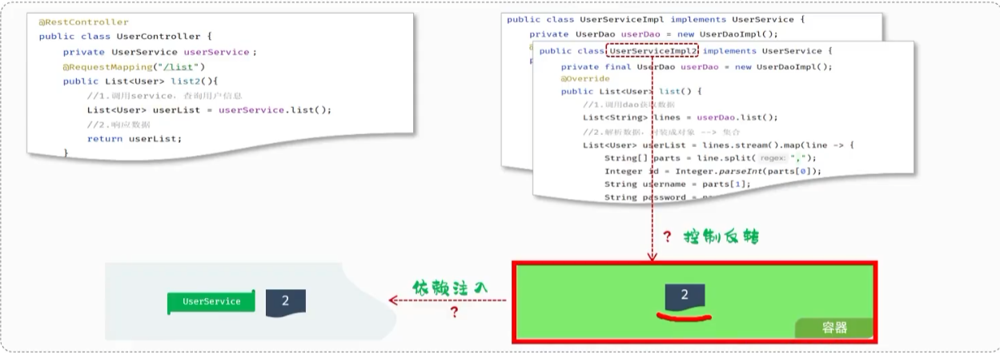

# 三层架构--遵循单一职责原则，便于复用、后期维护

## 一、三层职责

| 层              | 全称                     | 别称              | 职责原文                            |
| -------------- | ---------------------- | --------------- | ------------------------------- |
| **Controller** | —                      | 控制层 / 表现层       | 接收前端发送的**请求**，对请求进行处理，并**响应数据** |
| **Service**    | —                      | 业务逻辑层           | 处理**具体**的业务逻辑                   |
| **Dao**        | **Data Access Object** | 数据访问层 / **持久层** | 负责数据访问操作，包括数据的**增、删、改、查**       |

**口诀：Controller 接活，Service 干活，Dao 存取。**&#8203;

前端  -发出请求-> Controller(接收请求) --> Service(处理逻辑) --> Dao(数据访问)

Dao(数据访问) --> Service(处理逻辑) --> Controller(接收请求) -响应请求-> 前端

### 生活类比（最好记）
| 层 | 类比 | 做什么 |
|---|---|---|
| Controller | **前台** | 接单、端菜，不掌勺 |
| Service | **厨师** | 决定这菜怎么做、放不放辣 |
| Dao | **库房** | 只管取食材、存食材 |

# 三层架构代码落地（速览）

## 一条调用链

    UserController  →  UserServiceImpl  →  UserDaoImpl
       （接请求）        （解析+组装）       （读文件）

## 三个类各管什么

| 类 | 层 | 只做这一件事 | 返回什么 |
|---|---|---|---|
| `UserController` | 控制层 | 调 `service.list()`，直接返回 | `List<User>` |
| `UserServiceImpl` | 业务层 | 调 dao 拿原始数据 → **解析**（String 转 User） | `List<User>` |
| `UserDaoImpl` | 数据层 | 读 `user.txt`，**只负责读出来** | `List<String>` |

## 关键代码（每层就一句核心）

Controller —— 只管调，不管数据怎么来的：
```java
    @RestController
    public class UserController {
        private UserService userService = new UserServiceImpl();

        @RequestMapping("/list")
        public List<User> list() {
            return userService.list();
        }
    }
```

Service —— 脏活累活都在这：把一行行字符串**切开、转成对象**：
```java
    public List<User> list() {
        List<String> lines = userDao.list();          // 拿原始数据
        return lines.stream().map(line -> {           // 一行 → 一个 User
            String[] parts = line.split(",");
            return new User(Integer.parseInt(parts[0]), parts[1], ...);
        }).collect(Collectors.toList());
    }
```

Dao —— 只把文件读成字符串列表，**不认识 User**：
```java
    public List<String> list() {
        InputStream in = getClass().getClassLoader().getResourceAsStream("user.txt");
        return IoUtil.readLines(in, StandardCharsets.UTF_8, new ArrayList<>());
    }
```
## 一句话看透分工
- **Dao**：把文件变成 `List<String>`（一行一条，不认识 User）
- **Service**：把 `List<String>` 变成 `List<User>`（**解析在这**）
- **Controller**：把 `List<User>` 原样返回给前端

## 两个要留意的点
1. **数据格式的转换只发生在 Service** —— 这是业务逻辑，不是"读数据"，也不该在 Controller
2. 现在还是 `new UserServiceImpl()`、`new UserDaoImpl()` **硬编码**，
   换成别的实现就得改代码 → **下一节就是用 `@Autowired` 解耦**（IOC/DI 登场）


# 分层解耦：耦合、内聚、高内聚低耦合

## 一、三个概念（课件原文）

| 概念 | 定义 | 看的是"哪里" | 目标 |
|---|---|---|---|
| **耦合** | 衡量软件中各个**层 / 各个模块**的**依赖关联**程度 | 模块**之间** | **越低越好** |
| **内聚** | 软件中各个功能模块**内部**的功能联系 | 模块**内部** | **越高越好** |

**软件设计原则：高内聚低耦合。**&#8203;

### 一句话区分
- **耦合看"外向"**&#8203; —— 我和别人绑得多紧
- **内聚看"内向"**&#8203; —— 我自己人齐心不齐

    controller
        ↓        ← 这三条箭头就是"耦合"发生的地方
    service
        ↓
      dao

层与层之间必须调用，所以**耦合不可能为 0**；能做的是让它们**只通过接口联系**，别知道对方的具体实现。

## 二、当前代码到底哪里有问题

Controller 里：

    private UserService userService = new UserServiceImpl();   // ⚠ 问题在这

Service 里：

    private UserDao userDao = new UserDaoImpl();               // ⚠ 问题也在这

**问题：把"接口"和"具体实现"焊死了。**&#8203;

| 如果我想…… | 现在必须…… |
|---|---|
| 换一个 UserService 的实现类 | **改 Controller 的源码** |
| 把 Dao 从"读文件"改成"读数据库" | **改 Service 的源码** |

写代码时**直接 new 具体实现**，就等于告诉上层："我永远只用这一个"。
一旦要换，得把上层代码翻出来改 —— 这就是**紧耦合**。


# 解耦三概念：IOC / DI / Bean

## 三个定义

| 概念 | 全称 | 定义 | 一句话 |
|---|---|---|---|
| **控制反转** | **IOC**<br>Inversion Of Control | 对象的**创建控制权**由**程序自身**转移到**外部（容器）**&#8203; | **谁负责 new → 交给容器** |
| **依赖注入** | **DI**<br>Dependency Injection | 容器为应用程序**提供运行时**，所依赖的资源 | **容器把对象塞给你** |
| **Bean 对象** | — | **IOC 容器中创建、管理的对象** | **容器里被管着的那些对象** |

## 三者的关系（关键）

**IOC 是思想 → DI 是手段 → Bean 是产物**

- **IOC**：把"创建对象的权力"交出去（原来你 new，现在容器 new）
- **DI**：容器 new 完，还要**把它送进你的类里**（这就是"注入"）
- **Bean**：容器里所有被它创建和管理的对象，统一叫 Bean

缺一不可：光有 IOC 没 DI，对象造出来了但没人用得上。

## 代码上看变化

**之前（紧耦合）：**
    private UserService userService = new UserServiceImpl();

**现在（解耦后）：**
    private UserService userService;      // ← new 没了

**`new` 消失，就是 IOC 生效的标志。**&#8203;
这个字段的值，将由容器在运行时**注入**进来。

## 图示那三个箭头的含义

左图 Controller 里的 `userService` 和右图容器里的 `UserService` 对象，靠"**依赖注入**"连起来。
右侧容器里那个对象，就是 **Bean**。

## 一句话记
**IOC = 把 new 的权力交出去；DI = 容器把造好的对象送给你；Bean = 容器里造好的那些对象。**&#8203;


# IOC & DI 入门（两步搞定）

## 一、两步走

| 步 | 做什么 | 用什么 |
|---|---|---|
| ① | 将 **Dao 及 Service 层的实现类**，交给 IOC 容器管理 | `@Component` |
| ② | 为 **Controller 及 Service** 注入运行时依赖的对象 | `@Autowired` |

**一句话：① 让类"进容器"，② 让字段"从容器取"。**&#8203;

## 二、三个类的注解一览

| 类 | 加的注解 | 干了什么 |
|---|---|---|
| `UserDaoImpl` | `@Component` | 交给容器管（成为 **Bean**） |
| `UserServiceImpl` | `@Component` + `@Autowired` | 自己进容器 **+** 从容器拿 `UserDao` |
| `UserController` | `@RestController` + `@Autowired` | 自己进容器 **+** 从容器拿 `UserService` |

对应代码：
```java
    @Component
    public class UserDaoImpl implements UserDao {
        @Override
        public List<String> list() {
            InputStream in = getClass().getClassLoader().getResourceAsStream("user.txt");
            return IoUtil.readLines(in, StandardCharsets.UTF_8, new ArrayList<>());
        }
    }
```

```java
    @Component
    public class UserServiceImpl implements UserService {
        @Autowired
        private UserDao userDao;          // ← 不 new 了，容器送进来

        @Override
        public List<User> list() {
            List<String> lines = userDao.list();
            // 解析...（略）
        }
    }
```

```java
    @RestController
    public class UserController {
        @Autowired
        private UserService userService;  // ← 不 new 了，容器送进来
    }
```
## 三、三个必须搞懂的点

### ① Controller 为什么没加 `@Component`？
因为 **`@RestController` = `@Controller` + `@ResponseBody`，而 `@Controller` 内部已经包含了 `@Component`**。
所以 `@RestController` 本身就已经"交给容器管理"了，不用再加。

（同理：`@Service`、`@Repository` 也都是 `@Component` 的"马甲"，功能一样，只是语义更明确 —— 一看就知道这是哪一层）

### ② 谁需要加 `@Autowired`？
**只看一件事：这个类里有没有"要用别人"。**&#8203;

| 类 | 要用别人吗 | 加不加 |
|---|---|---|
| `UserController` | 要用 `UserService` | ✅ 加 |
| `UserServiceImpl` | 要用 `UserDao` | ✅ 加 |
| `UserDaoImpl` | 谁也不依赖 | ❌ 不加 |

### ③ `@Autowired` 能加在哪
- **字段上**（图上这种，最常见）
- 构造方法上
- setter 方法上

## 四、变化对比（一眼看穿）

| | 之前 | 现在 |
|---|---|---|
| Controller 拿 Service | `new UserServiceImpl()` | `@Autowired` 一个字段 |
| Service 拿 Dao | `new UserDaoImpl()` | `@Autowired` 一个字段 |
| 换实现类 | **改源码** | **不用改** |

## 五、易错点
1. **`@Autowired` 只能注入容器里的 Bean** —— 如果 `UserDaoImpl` 忘了加 `@Component`，启动直接报错（找不到 Bean）
2. **`@Component` 加在实现类上，不加在接口上** —— 接口不能实例化，容器造不出对象
3. `@Autowired` 默认**按类型注入**：容器里同类型有多个会报错（后面用 `@Qualifier` / `@Primary` 解决）
4. 别忘了 `@Autowired` 那个字段**不用也不能再 new**

## 六、一句话记
**打 `@Component` 的类 = 交给容器管；打 `@Autowired` 的字段 = 从容器要。**&#8203;
**一个"交出去"，一个"拿回来"，`new` 就这么消失了。**&#8203;


# IOC 详解：四个注解

## 一张表（课件原文）

| 注解 | 说明 | 位置 |
|---|---|---|
| `@Component` | 声明 bean 的**基础注解** | **不属于以下三类**时，用此注解 |
| `@Controller` | `@Component` 的**衍生注解** | 标注在**控制层**类上 |
| `@Service` | `@Component` 的**衍生注解** | 标注在**业务层**类上 |
| `@Repository` | `@Component` 的**衍生注解** | 标注在**数据访问层**类上（由于与 mybatis 整合，用的少） |

## 怎么选（就一条规律）

| 这个类属于…… | 用哪个 |
|---|---|
| 控制层（接请求的） | `@Controller`（实际写 `@RestController`） |
| 业务层（算逻辑的） | `@Service` |
| 数据访问层（碰数据库的） | `@Repository`（**实际很少用**） |
| 哪个都不是（工具类、配置类） | `@Component` |

**规律：能对上三层就用对应的马甲，对不上就兜底用 `@Component`。**&#8203;

## 为什么要分四个（功能其实一模一样）
它们**作用完全相同** —— 都是把类交给 IOC 容器管理。
区别只在**语义**：一看注解就知道这个类属于哪一层，团队协作时不用点进去看。

## 三个要记住的点
1. **`@Controller` / `@Service` / `@Repository` 都是 `@Component` 的衍生注解**，功能没差别
2. 控制层我们一般直接写 **`@RestController`**（= `@Controller` + `@ResponseBody`），效果一样
3. **`@Repository` 实际用得少** —— 因为 Dao 层后面基本交给 MyBatis 的 `@Mapper` 去标注了


## 补充：Bean 的名字怎么定

### 规则（课件原文）
声明 bean 的时候，可以**通过注解的 value 属性指定 bean 的名字**；
如果**没有指定，默认为类名首字母小写**。

## 一句话记
**`@Component` 是本体，另外三个是马甲；一层配一个，对不上就用本体。**&#8203;

---

# IOC 详解：@ComponentScan 组件扫描

## 一、核心两条（课件原文）
1. 前面声明 bean 的**四大注解，要想生效，还需要被组件扫描注解 `@ComponentScan` 扫描**
2. 该注解**虽然没有显式配置，但实际上已经包含在了启动类声明注解 `@SpringBootApplication` 中**，默认扫描的范围是**启动类所在包及其子包**

**一句话：四个注解是"报名"，`@ComponentScan` 才是"点名"。名没点到，报了也白报。**&#8203;

## 二、扫描范围（决定目录怎么摆）

    启动类所在包 com.itheima + 它下面所有子包

所以正确的目录结构长这样：

    src/main/java
      └── com.itheima                      ← 启动类放在这一层
            ├── TliasManagementApplication ← 启动类
            ├── controller
            ├── service
            ├── dao
            └── pojo

四个业务包和启动类**平级**，全是 `com.itheima` 的子包 → **全部都能扫到**。

## 三、放错位置会怎样（反例）

| 启动类位置 | 扫描范围 | 结果 |
|---|---|---|
| `com.itheima`（最外层） | `com.itheima` 及子包 | ✅ 四个包全覆盖 |
| `com.itheima.controller` | 只有 `controller` 子包 | ❌ service / dao 扫不到 → **启动就报错找不到 Bean** |

**规则：启动类必须放在项目的最外层包下，和 controller / service / dao 平级。**&#8203;
这条规则记不住的时候，想一句话： **“点名的人站在最外圈，才喊得到所有人。”** &#8203;

## 四、实在不方便移动启动类怎么办
可以手动加注解指定扫描范围：

```java
    @SpringBootApplication
    @ComponentScan("com.itheima")     // 显式指定
    public class TliasManagementApplication {
        public static void main(String[] args) {
            SpringApplication.run(TliasManagementApplication.class, args);
        }
    }
```
一般用不上 —— 把启动类放最外层就是标准做法。

## 五、易错点
1. **`@ComponentScan` 你从来没写过，不代表它没生效** —— 它藏在 `@SpringBootApplication` 里了
2. **扫描的是"包"，不是"类"**&#8203; —— 只要类在范围内，加不加注解都会被"看到"；加不加注解决定的是"要不要交给容器"
3. **新建包时别建到 `com.itheima` 外面去**（比如 `com.example`），那样扫不到，是新手最常见的坑
4. 扫描范围**只往下，不往上也不往旁边** —— 兄弟包（如 `com.itheima2`）扫不到

## 六、一句话记
**`@SpringBootApplication` 里已经内置了 `@ComponentScan`，默认只扫启动类所在包及其子包。**&#8203;
**所以启动类放最外层，四个业务包和它平级 —— 这样就万无一失。**&#8203;

---

# DI 详解：@Autowired 的三种注入方式

## 一、三种方式对比（核心）

| 方式 | 注解加在哪 | 优点 | 缺点 |
|---|---|---|---|
| **① 属性注入** | **字段**上 | 代码简洁、方便快速开发 | **隐藏**了类之间的依赖关系、可能**破坏类的封装性** |
| **② 构造器注入** | **构造方法**上 | 能**清晰地看到**类的依赖关系、**提高了代码的安全性** | 代码繁琐，构造参数过多会导致构造函数臃肿 |
| **③ setter 注入** | **setter 方法**上 | 保持了类的**封装性**，依赖关系更清晰 | 需额外编写 setter 方法，增加了代码量 |

## 二、三种写法对照

**① 属性注入（最常用、最短）**&#8203;
```java
    @RestController
    public class UserController {
        @Autowired
        private UserService userService;
    }
```

**② 构造器注入（最规范）**&#8203;
```java
    @RestController
    public class UserController {
        private final UserService userService;

        @Autowired
        public UserController(UserService userService) {
            this.userService = userService;
        }
    }
```

**③ setter 注入（最传统）**&#8203;
```java
    @RestController
    public class UserController {
        private UserService userService;

        @Autowired
        public void setUserService(UserService userService) {
            this.userService = userService;
        }
    }
```
## 三、为什么说构造器注入"更安全"？

关键在那个 **`final`**：

    private final UserService userService;

- **属性注入**的字段**不能**加 `final`（它不是构造时赋值的）
- **构造器注入**可以加 `final` → 对象一旦造好，**依赖就不可更改**

这就叫"提高代码的安全性" —— 不会出现"用着用着依赖被换掉了"的情况。

同时它还有两个隐藏好处（课件没写但很实用）：
1. **依赖关系写在构造函数签名上**，一眼就知道这个类需要什么
2. **方便单元测试** —— 直接在 `new` 的时候把 mock 对象传进去，不需要起 Spring 容器

## 四、构造器注入的细节
**如果只有一个构造方法，`@Autowired` 注解可以省略。**&#8203;

（Spring 4.3+ 的规则：单构造器自动注入。但**多个构造方法时必须要加**，否则 Spring 不知道该用哪个。）

## 五、实际开发怎么选

| 场景 | 推荐 |
|---|---|
| 课件演示 / 快速开发 / 小项目 | **属性注入**（代码最短） |
| 生产代码 / 正式项目 | **构造器注入**（Spring 官方推荐） |
| 可选依赖（可能不用注入） | setter 注入 |

**现在写代码用属性注入就够了**，等以后写正式项目再换构造器注入，思路是一样的。

## 六、易错点
1. 属性注入的字段**不能加 `final`** —— 加了编译不过（final 必须在构造时赋值）
2. 构造器注入时字段**最好加 `final`**，这才是它的价值所在
3. **一个类里有多个构造方法时，`@Autowired` 必须显式加**
4. 三种方式**不要混用**在同一个依赖上，选一种就好
5. 属性注入最省事但"藏依赖"：光看类的字段声明，看不出它到底依赖谁（被 private 挡住了）

## 七、一句话记
**属性注入最省事但藏依赖，构造器注入最啰嗦但最安全，setter 注入居中。**&#8203;
**课件用属性注入，实际项目用构造器注入 —— 原理完全一样，都是"容器把对象给你"。**&#8203;

---

# DI 详解：多个同类型 Bean 怎么办

## 一、问题从哪来

**`@Autowired` 注解，默认是按照「类型」进行注入的。**&#8203;

所以容器里如果存在**多个相同类型的 bean**，它不知道给哪个，直接报错：

    Field userService in com.itheima.controller.UserController
    required a single bean, but 2 were found:
      - userServiceImpl
      - userServiceImpl2
    Action:
      Consider marking one of the beans as @Primary,
      updating the consumer to accept multiple beans,
      or using @Qualifier to identify the bean that should be consumed

**报错信息其实已经把三个方案告诉你了。**&#8203;

## 二、三个方案对比

| 方案 | 注解 | **加在哪** | 说明 |
|---|---|---|---|
| 一 | `@Primary` | **Bean 上**（Service 实现类） | 声明"优先选我"，注入点不用改 |
| 二 | `@Qualifier("bean名")` | **注入点**（字段上） | 指定用哪一个，**必须配合 `@Autowired`** |
| 三 | `@Resource(name="bean名")` | **注入点**（字段上） | **JDK 提供**，独立使用，**不配 `@Autowired`** |

⭐ **最关键的区别：`@Primary` 贴在"被选的人"身上，`@Qualifier` / `@Resource` 贴在"挑人的人"身上。**&#8203;

## 三、三种写法

**方案一：@Primary（加在实现类）**&#8203;
```java
    @Primary
    @Service
    public class UserServiceImpl implements UserService {
        // 这个会被优先选中
    }
```

**方案二：@Qualifier（加在注入点，配合 @Autowired）**&#8203;
```java
    @RestController
    public class UserController {
        @Autowired
        @Qualifier("userServiceImpl")      // 写 Bean 的名字
        private UserService userService;
    }
```

**方案三：@Resource（加在注入点，独立使用）**&#8203;
```java
    @RestController
    public class UserController {
        @Resource(name = "userServiceImpl")   // JDK 的注解，不用 @Autowired
        private UserService userService;
    }
```

## 四、注入时的匹配顺序（搞懂这个就不会乱）

    @Autowired
        ↓ ① 按类型找
     找到唯一一个 → 直接用 ✅
     找到多个   → ② 看有没有 @Primary  → 有就用它 ✅
                  → ③ 看注入点有没有 @Qualifier / @Resource 指定名字 → 用它 ✅
                  → 都没有 → 报错 ❌

## 五、怎么选

| 场景 | 用哪个 |
|---|---|
| 确实有一个"主实现"，其他是备选 | `@Primary` |
| 某个注入点要特殊指定 | `@Qualifier` |
| 想少写一个注解 | `@Resource`（一个顶俩） |

## 六、易错点
1. **`@Primary` 只能标一个** —— 标两个照样报错
2. **`@Qualifier` 不能单独用**，必须跟 `@Autowired` 一起（它是"修饰"而不是"注入"）
3. **`@Resource` 是 JDK 的**（`javax.annotation.Resource` / Spring Boot 3 里是 `jakarta.annotation.Resource`），**不是 Spring 的**
4. `@Resource` **不写 `name` 时**，会先拿**字段名**当 bean 名去找；找不到再退化成按类型
5. **`@Qualifier` 里写的是 Bean 的名字**（默认是类名首字母小写，也可以被 `@Service("xxx")` 改过）
6. 名字写错了不是"找不到就随便给一个"，而是**直接报错**

## 七、一句话记
**`@Autowired` 按类型找，找到多个就懵。**&#8203;
**`@Primary` 说"优先选我"（贴在实现类上）；`@Qualifier` / `@Resource` 说"我要那一个"（贴在字段上）。**&#8203;
