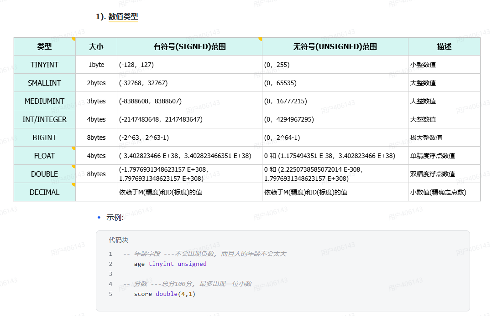
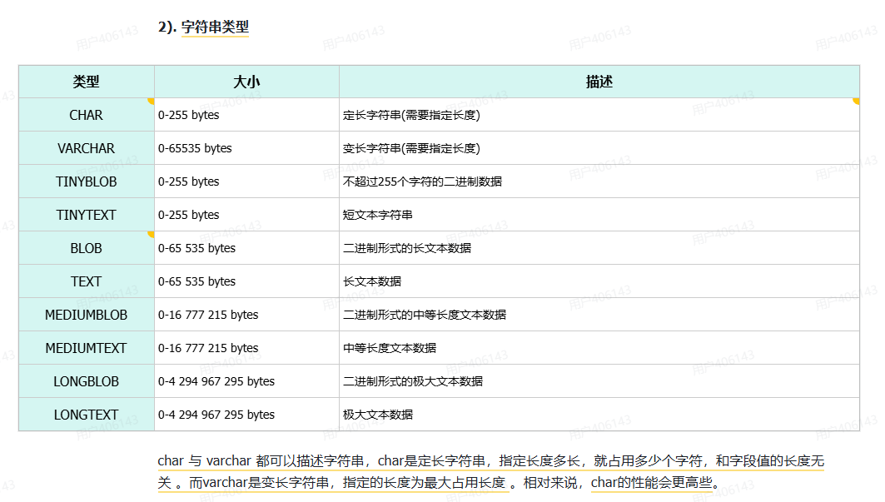
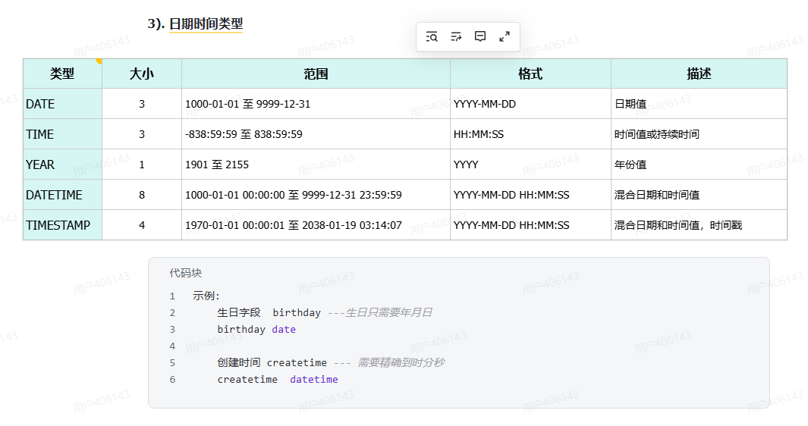

# SQL 及四大分类

## 一、SQL 是什么
**一门操作关系型数据库的编程语言，定义操作所有关系型数据库的统一标准。**&#8203;

关键词：**统一标准** —— 学一套 SQL，MySQL / Oracle / PostgreSQL 通用。

## 二、四大分类

| 分类 | 全称 | 说明 |
|---|---|---|
| **DDL** | Data **Definition** Language | 数据**定义**语言，定义数据库对象（数据库、表、字段） |
| **DML** | Data **Manipulation** Language | 数据**操作**语言，对数据库表中的数据进行**增删改** |
| **DQL** | Data **Query** Language | 数据**查询**语言，查询数据库中表的记录 |
| **DCL** | Data **Control** Language | 数据**控制**语言，创建数据库用户、控制访问权限 |

## 三、一句话记住各管什么

| 分类 | 管什么 | 记法 |
|---|---|---|
| DDL | 数据库 / 表 / 字段（**结构**） | **建壳** |
| DML | 表里记录（**增删改**） | **改数** |
| DQL | 表里记录（**查询**） | **查数** |
| DCL | 用户 / 权限（**人**） | **管人** |

口诀：**DDL 建壳，DML 改数，DQL 查数，DCL 管人。**&#8203;

## 四、一个关键区分
- **DDL 操作"结构"**&#8203; → 数据库、表、字段
- **DML / DQL 操作"数据"**&#8203; → 表里的那一行行记录

**DDL 是画表格，DML / DQL 是往表格里填字、改字、找字。**&#8203;

## 五、学习重点
| 分类 | 重要程度 |
|---|---|
| **DQL** | ⭐⭐⭐ 最重，查询花样最多 |
| **DML** | ⭐⭐ 日常必用（增删改） |
| **DDL** | ⭐ 会建库建表就行 |
| **DCL** | 基本用不到（DBA 负责） |

---

# DDL —— 操作数据库

## 五条命令（背这张表）

| 操作 | 语法 |
|---|---|
| **查询**所有数据库 | `show databases;` |
| **查询**当前数据库 | `select database();` |
| **使用**/切换数据库 | `use 数据库名;` |
| **创建**数据库 | `create database [if not exists] 数据库名 [default charset utf8mb4];` |
| **删除**数据库 | `drop database [if exists] 数据库名;` |

**方括号 `[]` 里的内容 = 可选**，写不写都能跑。

## 逐条说明

**① `show databases;`**
列出这台 MySQL 里**所有**的数据库，包括系统自带的（`information_schema`、`mysql`、`performance_schema`、`sys`）。

**② `select database();`**
看自己**当前在哪个库**里。一个都没选过时返回 `NULL`。

**③ `use 数据库名;`**
切换数据库。切完之后你执行的操作都针对这个库。
切换成功会提示 `Database changed`。

**④ `create database 数据库名;`**
建库。加上可选部分就是：

    create database if not exists itheima;                    -- 已存在也不报错
    create database itheima default charset utf8mb4;          -- 指定字符集

**⑤ `drop database 数据库名;`**
删库。⚠️ **真删除，没有回收站**，库里的表和数据全部消失。

    drop database if exists itheima;    -- 不存在也不报错

## 课件两条注意（重要）
1. **`database` 可以替换成 `schema`** —— 两者是**同义词**，效果完全一样
   `create schema db01;` 等价于 `create database db01;`
2. **MySQL 8 中默认字符集就是 `utf8mb4`**，所以一般不写也行
   （MySQL 5.7 默认是 `latin1`，**必须手动指定**，否则中文直接乱码）

## 易错点
1. **每条语句结尾要加分号 `;`** —— 不加不会报错，但语句不执行（命令行会一直等你继续输入）
2. **`use` 之后建议 `select database();` 确认一下** —— 切错库是排查半天才发现的那种坑
3. **`utf8` ≠ `utf8mb4`** —— MySQL 里的 `utf8` 是**只有 3 字节的不完整版本**，存不了 emoji；
   要用**真正的 UTF-8 必须写 `utf8mb4`**（4 字节）
4. **`drop` 是删库不是删表** —— 库没了，里面所有表一起没
5. `if not exists` / `if exists` 只是**抑制报错**，不是"保护" —— `drop` 加了 `if exists` 照样真删

## 一句话记
**`show` 看全部，`select database()` 看当前，`use` 切库，`create` 建库，`drop` 删库。**&#8203;
**方括号里的是可选参数；库名用 `database` 或 `schema` 都行；字符集认准 `utf8mb4`。**&#8203;


---

# DDL —— 表结构 · 创建

## 一、建表语法

    create table 表名(
        字段1  字段类型  [约束]  [comment 字段1注释],
        ... ...
        字段2  字段类型  [约束]  [comment 字段2注释]
    ) [comment 表注释];

**方括号 = 可选，其余必填。**&#8203;

## 二、逐段拆解

| 部分 | 作用 | 例子 |
|---|---|---|
| `create table 表名` | 声明要建表 | `create table tb_user` |
| `( ... )` | **字段列表**，每个字段占一行，用**逗号**分隔 | — |
| **字段名** | 这一列叫什么 | `username` |
| **字段类型** | 这列存什么数据 | `varchar(20)`、`int`、`tinyint` |
| `[约束]` | 给这列加的规则 | `not null`、`primary key` |
| `[comment 注释]` | 给字段写的说明 | `comment '用户名'` |
| `[comment 表注释]` | 整张表的说明，写在**括号外** | `comment '用户表'` |

⭐ **注意注释的位置**：字段注释在**字段后面**，表注释在**最后一行括号外**。

## 三、照着右边的表写出来就是

| id | username | name | age | gender |
|---|---|---|---|---|
| 1 | qingyifuwang | 韦一笑 | 45 | 男 |
| 2 | baimeiyingwang | 殷天正 | 55 | 男 |
| 3 | jinmaoshiwang | 谢逊 | 50 | 男 |
| 4 | zishanlongwang | 黛绮丝 | 38 | 女 |

    create table tb_user (
        id       int              comment 'ID，唯一标识',
        username varchar(20)      comment '用户名',
        name     varchar(10)      comment '姓名',
        age      tinyint unsigned comment '年龄',
        gender   char(1)          comment '性别'
    ) comment '用户表';

**从表到语句的对应关系：**
- 每一**列** → 一个**字段定义**
- 每一**列的数据样子** → 决定**字段类型**（数字用 `int`/`tinyint`，文字用 `varchar`/`char`）

## 四、易错点
1. **最后一个字段后面不能加逗号** —— 加了直接报语法错误（前面几个都必须加）
2. **字段名和字段类型之间是空格，不是逗号** —— 逗号只用来分隔"字段与字段"
3. **`comment` 写在字段类型之后**，还带着 `[约束]`；顺序是：`字段名 类型 约束 注释`
4. **表名 / 字段名尽量别用中文和关键字**（真要写中文得用反引号 `` ` `` 包起来）
5. **括号一定要配对**，末尾记得加分号 —— 少一个括号报错信息很难看懂
6. `comment` 只是**给人和工具看的说明**（比如生成文档、Navicat 里显示），不影响数据本身

## 五、一句话记
**`create table 表名( 字段名 类型 [约束] [comment 注释], ... ) [comment 表注释];`**
**逗号只分隔字段，最后一个字段不加逗号，表注释写在括号外面。**&#8203;


---

# DDL —— 表结构 · 创建（约束）

## 一、定义
- **约束：是作用于表中字段上的规则，用于限制存储在表中的数据。**&#8203;
- **目的：保证数据库中数据的正确性、有效性和完整性。**&#8203;

一句话理解：**约束就是给字段立的规矩** —— 什么能存、什么不能存。

## 二、五种约束（背这张表）

| 约束 | 描述 | 关键字 |
|---|---|---|
| **非空约束** | 限制该字段值**不能为 null** | `not null` |
| **唯一约束** | 保证字段的所有数据都是**唯一、不重复**的 | `unique` |
| **主键约束** | 主键是**一行数据的唯一标识**，要求**非空且唯一** | `primary key` |
| **默认约束** | 保存数据时，如果**未指定**该字段值，则采用默认值 | `default` |
| **外键约束** | 让**两张表的数据建立连接**，保证数据的一致性和完整性 | `foreign key` |

## 三、图上那些蓝色标签 = 约束

| 字段 | 标签 | 该加的约束 |
|---|---|---|
| id | 唯一标识 | `primary key` |
| username | 非空 | `not null` |
| name | 唯一 | `unique` |
| age | 非空 | `not null` |
| gender | 默认:男 | `default '男'` |

## 四、加上约束后的建表语句

    create table tb_user (
        id       int           primary key auto_increment comment 'ID，唯一标识',
        username varchar(20)   not null unique            comment '用户名',
        name     varchar(10)   not null                   comment '姓名',
        age      tinyint unsigned                         comment '年龄',
        gender   char(1)       default '男'               comment '性别'
    ) comment '用户表';

（`auto_increment` 是主键自增，后面讲；这里知道它常跟主键一起用就行）

## 五、记忆要点

| 约束 | 一句话 |
|---|---|
| `not null` | **不许空** |
| `unique` | **不许重复** |
| `primary key` | **不许空 + 不许重复**（= 前两者的组合） |
| `default` | **不填就给你一个默认值** |
| `foreign key` | **管两张表之间的事** |

⭐ 最大的一个点：**主键约束 = 非空约束 + 唯一约束**，它是行数据的"身份证号"。

## 六、易错点
1. **一张表只能有一个主键** —— 想用两个字段共同做主键叫"联合主键"，是另一回事
2. **`unique` 允许为 null，`primary key` 不允许** —— 这是两者最容易混的地方
3. **`default` 只在"完全不写这个字段"时生效** —— 你显式写 `null`，它不会帮你换成默认值
4. **约束加在"字段类型之后"**&#8203; —— 顺序是 `字段名 类型 约束 comment 注释`
5. **`foreign key` 实际项目里用得很少** —— 因为会影响性能、增加维护成本，多数公司靠**代码层面**保证关联正确
6. 约束是**写入时的防线** —— 数据已经在表里了，再加约束不会回头清理旧数据

## 七、一句话记
**约束 = 给字段立的规矩，目的是保证数据的正确性、有效性、完整性。**&#8203;
**`not null` 不许空，`unique` 不许重，`primary key` 两样都要，`default` 兜底，`foreign key` 连两张表。**&#8203;

---

# 数据类型

## 一句话
**MySQL 中的数据类型有很多，主要分为三类：数值类型、字符串类型、日期时间类型。**&#8203;

## 三类先眼熟

| 类别 | 代表类型 | 存什么 |
|---|---|---|
| **数值类型** | `tinyint` / `int` / `bigint` / `double` / `decimal` | 数字 |
| **字符串类型** | `char` / `varchar` / `text` | 文字 |
| **日期时间类型** | `date` / `time` / `datetime` / `timestamp` | 时间 |

## 1.数值类型


```SQL
	tinyint           → -128 ~ 127
    tinyint unsigned  → 0 ~ 255
```
## 2.字符串类型

```SQL
示例： 
    用户名 username ---长度不定, 最长不会超过50
    username varchar(50)
    
    手机号 phone ---固定长度为11
    phone char(11)
```

char(10): 固定占用10个字符空间; 存储A, 占用10个空间; 存储ABC, 占用10个空间;  
varchar(10): 最多占用10个字符空间; 存储A, 占用1个空间; 存储ABC, 占用3个空间;
**定长用 CHAR，变长用 VARCHAR**
## 3.日期时间类型


---

# DDL —— 表结构的查询、修改、删除

## 一、查询（3 条）

| 命令 | 作用 |
|---|---|
| `show tables;` | 查询**当前数据库**的所有表 |
| `desc 表名;` | 查询表结构（有哪些字段、什么类型、能不能为空） |
| `show create table 表名;` | 查询**建表语句**（能看出 comment 和约束） |

`desc` 是 `describe` 的缩写，**只能看结构，看不到注释和约束**；
想看完整的原始建表语句 → 用 `show create table`。

## 二、修改表结构（5 条 alter）

| 操作 | 语法 |
|---|---|
| **添加字段** | `alter table 表名 add 字段名 类型(长度) [comment 注释] [约束];` |
| **修改字段类型** | `alter table 表名 modify 字段名 新数据类型(长度);` |
| **修改字段名 + 类型** | `alter table 表名 change 旧字段名 新字段名 类型(长度) [comment 注释] [约束];` |
| **删除字段** | `alter table 表名 drop column 字段名;` |
| **修改表名** | `alter table 表名 rename to 新表名;` |

**共同点：全部以 `alter table 表名` 开头**，后面接动作。

`modify` 和 `change` 的区别就一句话：
- **`modify` 只改类型** —— 字段名照抄一遍就行
- **`change` 改名（也能顺带改类型）**&#8203; —— 旧名新名都要写

    -- 加个字段
    alter table tb_user add gender char(1) comment '性别';

    -- 只改类型
    alter table tb_user modify username varchar(30);

    -- 改名 + 改类型
    alter table tb_user change name nickname varchar(20) comment '昵称';

    -- 删字段
    alter table tb_user drop column nickname;

    -- 改表名
    alter table tb_user rename to user;

## 三、删除表

    drop table [if exists] 表名;

⚠️ 课件明写：**删除表时，表中的全部数据也会被删除。**&#8203;

## 四、易错点

| # | 坑 |
|---|---|
| 1 | **`show tables;` 前必须先 `use 库名;`** —— 没选库会报 `No database selected` |
| 2 | **`modify` 是"重写"字段定义** —— 原来有 `not null` / `comment`，你写 `modify` 时没带上，就**丢了** |
| 3 | **`change` 必须写两遍字段名**（旧、新），少写一个直接语法错误；不打算改名时用 `modify` 更省事 |
| 4 | **`drop column` 删的是"字段"，`drop table` 删的是"表"**&#8203; —— 一个加 `column`，一个不加 |
| 5 | **`drop table` 是真删** —— 表和数据一起没，没有回收站；`if exists` 只是**抑制报错**，不是保护 |
| 6 | **`alter` 改类型可能丢数据** —— 比如 `varchar(50)` 改成 `varchar(5)`，超长部分会被截断 |
| 7 | **改表名用 `rename to`，不是 `modify`** —— 改字段名才用 `change` / `modify` |
| 8 | 字段名是**关键字或中文**时要用反引号包起来：`` alter table `user` add `name` varchar(10); `` |

## 五、一句话记
**查表：`show tables` 看有哪些表，`desc` 看结构，`show create table` 看原始建表语句。**&#8203;
**改表全是 `alter table 表名` 开头：`add` 加、`modify` 改类型、`change` 改名、`drop column` 删字段、`rename to` 改表名。**&#8203;
**`drop table` 一删全没，动手前先 `desc` 看一眼。**&#8203;
